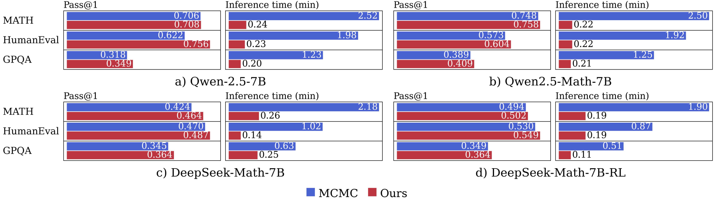

# Scalable Power Sampling

Code for [Scalable Power Sampling: Unlocking Efficient, Training-Free Reasoning for LLMs via Distribution Sharpening](https://arxiv.org/abs/2601.21590), **ICML 2026**.



## Installation


```bash
git clone --branch scalable_power_sampling --single-branch https://github.com/huawei-noah/hebo.git scalable-power-sampling
cd scalable-power-sampling

python -m pip install -r requirements.txt
```

## Sampling

```bash
# MATH500 — Qwen2.5-Math-7B
python power_sampling.py --config configs/math500_qwen_math_7b.yaml

# GPQA — Qwen2.5-7B
python power_sampling.py --config configs/gpqa_qwen_7b.yaml

# HumanEval — Qwen2.5-7B
python power_sampling.py --config configs/humaneval_qwen_7b.yaml
```

Sampling parameters and output paths are set in `configs/`. Results are saved as JSONL files under `results/`.

## Evaluation

```bash
python eval.py --dataset MATH --input results/math500_qwen_math_7b.jsonl
python eval.py --dataset GPQA --input results/gpqa_qwen_7b.jsonl
python eval.py --dataset HUMANEVAL --input results/humaneval_qwen_7b.jsonl
```

HumanEval uses the bundled `data/HumanEval.jsonl`. Run its evaluator in an isolated environment because it executes generated code.

## Citation

If you use this code in your research, please cite the paper:

```bibtex
@inproceedings{ji2026scalable,
      title={Scalable power sampling: Unlocking efficient, training-free reasoning for llms via distribution sharpening}, 
      author={Ji, Xiaotong and Tutunov, Rasul and Zimmer, Matthieu and Ammar, Haitham Bou},
      booktitle={Proceedings of the International Conference on Machine Learning (ICML)},
      year={2026},
      url={https://arxiv.org/abs/2601.21590}, 
}
```

## Acknowledgements

See [THIRD_PARTY_NOTICES.md](THIRD_PARTY_NOTICES.md) for third-party code and dataset attribution.
